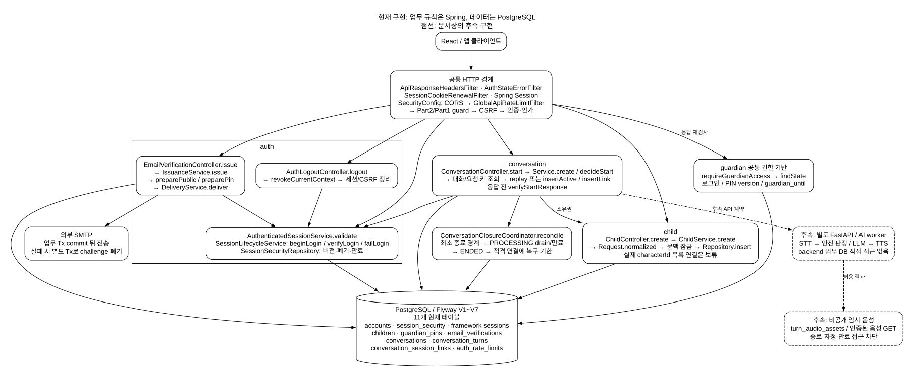
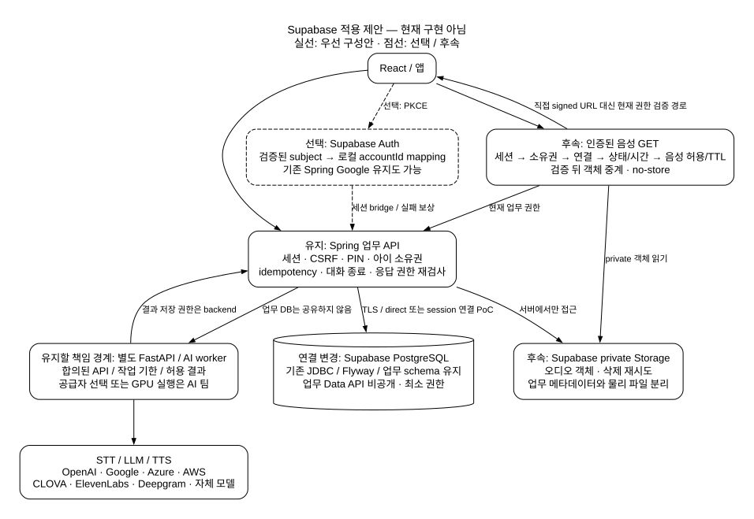

# 코드 지도와 Supabase 검토

2026-11-15 작업 파일을 포함하고 2026-11-16 검증을 마친 분석이다. 운영 코드·DB·인증 방식을 이 문서 작업으로 바꾸지 않았다.

**처음 읽는 담당자는 [시작 화면](DodamDodam-Code-Map/00-Start.md) → 담당 요청 흐름 → 실제 메서드 순서로 확인한다.** 기능 6개로 책임을 요약하고, 주요 요청 7개를 각각 6단계로 나눴다. 전체 호출 지도는 누락·영향 범위를 조사할 때 여는 참조 자료다.

| 자료 | 내용 |
| --- | --- |
| [Obsidian 시작 페이지](DodamDodam-Code-Map/00-Start.md) | 맡은 작업으로 진입, 현재 구현과 후속 작업 구분 |
| [한눈에 보는 구조](DodamDodam-Code-Map/Assets/00-Overview.svg) · [Canvas](DodamDodam-Code-Map/00-Overview.canvas) | 공통 요청·인증·아이·대화·보호자·실행 기반의 역할 6개 |
| [이메일 발급](DodamDodam-Code-Map/Flows/02-email.md) · [아이 등록](DodamDodam-Code-Map/Flows/03-child.md) · [대화 시작](DodamDodam-Code-Map/Flows/04-conversation.md) | 진입·결과·6단계 그림·실제 메서드·실패 조건 |
| [공통 요청 검사](DodamDodam-Code-Map/Flows/01-request.md) · [세션](DodamDodam-Code-Map/Flows/05-session.md) · [보호자](DodamDodam-Code-Map/Flows/06-guardian.md) · [종료 조정](DodamDodam-Code-Map/Flows/07-closure.md) | 공통 경계와 내부 서비스의 사용 계약 |
| [전체 참조 자료](DodamDodam-Code-Map/90-Reference.md) | 106개 타입·566개 메서드/생성자·541개 내부 호출 쌍을 보존한 전체 SVG·Canvas |
| [현재 구조와 요청 흐름 도식](architecture.md) | 구현된 범위, HTTP·필터·이메일·세션·아이·대화·종료 처리 |
| [전체 클래스·메서드 목록](method-catalog.md) | 106개 타입, 직접 작성 271개/자동 생성 295개 멤버의 정의·호출자·호출 대상·소스 위치 |
| [Supabase와 주요 대안](supabase-assessment.md) | 유지/변경 클래스, OAuth·Storage·AI 경계, 주요 인프라·음성 공급자 비교, 비용 산식·도입 순서 |
| [현재 구조 그림](system-overview.svg) | 실선은 현재 연결, 점선은 후속 구현 |
| [Supabase 적용 제안 그림](supabase-proposal.svg) | 현재 코드와 구분한 후속 구성안 |
| [분석 데이터](method-map.json) | javac로 해석한 클래스·메서드·호출 지점, 별도 프레임워크 진입 |
| [소스 스냅샷](snapshot.json) | 브랜치·HEAD·미커밋 파일 포함 여부·소스별 SHA-256·정적 분석 한계 |
| [분석 자료 검증 결과](verification.json) | 소스 해시·목록 연결·SVG·검색/호출 이동·화면 폭 검증과 미실행 범위 |

대화의 호출 지도에서는 클래스·메서드를 검색하고 `호출자 → 선택 메서드 → 호출 대상`을 따라 이동할 수 있다. 이 문서 묶음은 해당 시점의 스냅샷이며 코드 변경 후 자동 갱신되지 않는다. 메서드 참조는 즉시 실행이 아닌 콜백 등록일 수 있고, Spring 진입이나 가상 호출 전체를 Java 직접 호출과 동일하게 취급하지 않는다.

Obsidian은 이미 등록된 **`backend/docs`** 보관소를 그대로 사용한다. `DodamDodam-Code-Map/00-Start.md`를 읽기 보기로 열고 요청별 흐름을 선택한다. 본문 링크나 Canvas 카드의 메서드 링크를 누르면 정확한 정의·소스 코드·양방향 호출 관계로 이동한다. 클래스 노트는 역할과 작성 메서드를 먼저 보여주며 생성자·자동 멤버 목록은 접혀 있다. 커뮤니티 플러그인은 필요하지 않다. 그림은 정적 요약이고 코드 블록은 사본이므로 제품 소스와 자동 동기화되지 않는다.

생성 자료의 연결·누락·좌표 겹침 검증은 다음 명령으로 실행한다. 결과는 [Obsidian 자료 검증 기록](DodamDodam-Code-Map/verification.json)에 남긴다.

```sh
python3 docs/analysis/2026-11-15-codebase/support/verify_call_vault.py
```

## 현재 구조



## Supabase 적용 제안



정적 그림의 원본은 같은 폴더의 `.dot` 파일이다. Graphviz가 있으면 `dot -Tsvg <원본.dot> -o <그림.svg>`로 렌더링할 수 있다. 상세 요청 흐름 Mermaid 원본은 `architecture.md`에 있다.
