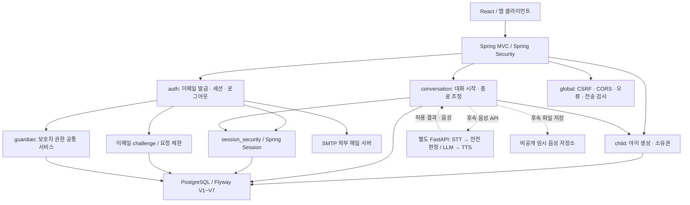
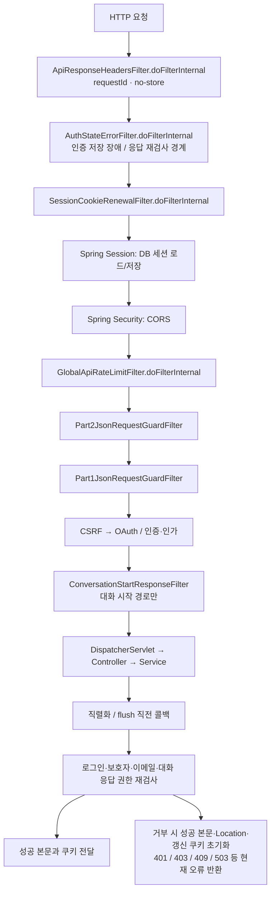
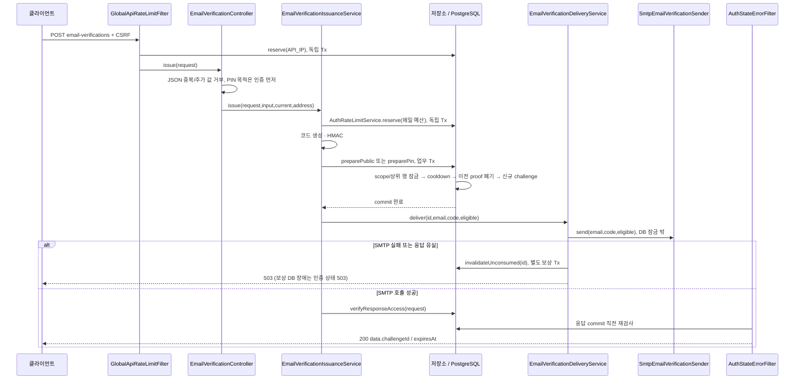
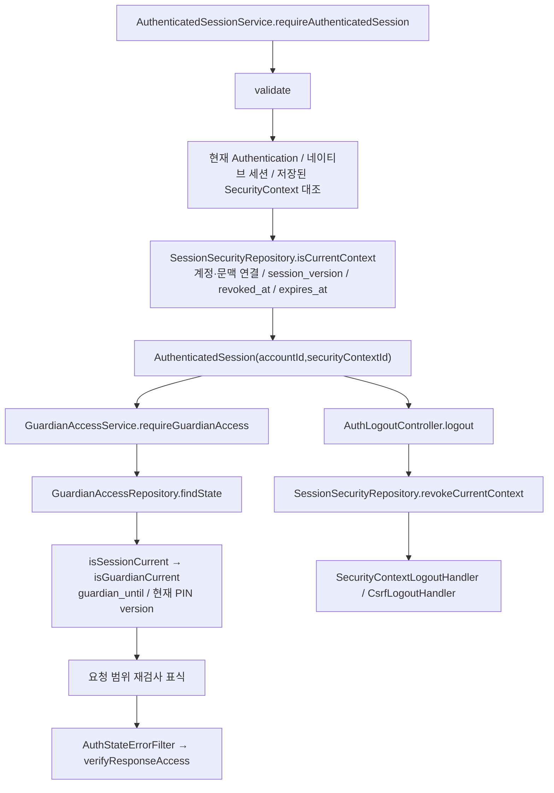
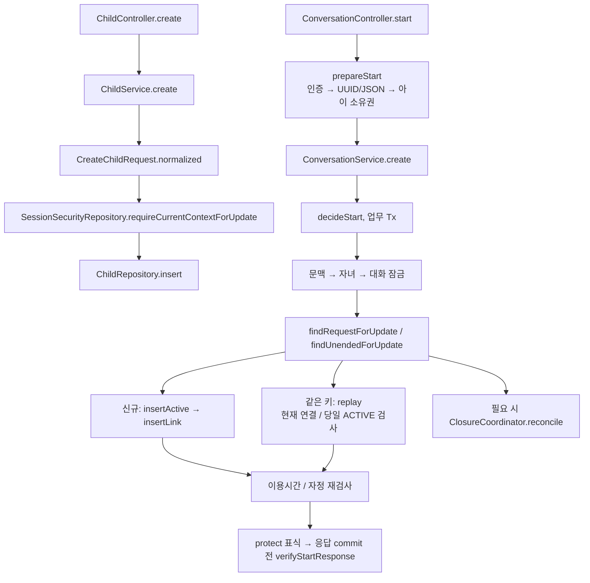
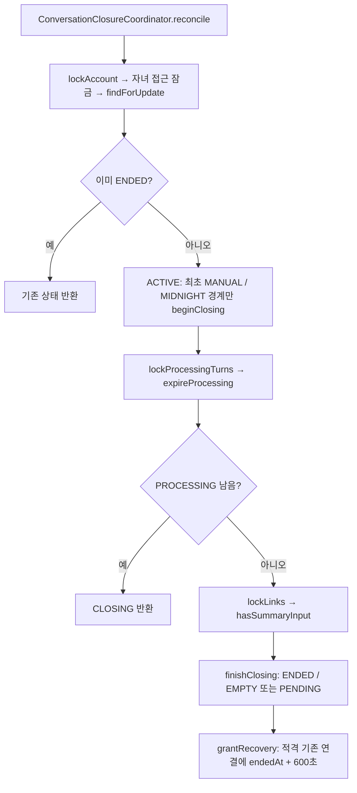

# 현재 코드 구조와 호출 흐름

분석 기준은 2026-11-15, `feature/SCRUM-77-email-issuance`, HEAD `40db54d5d5d54400b3f70f32795cab05da0f009b`와 **커밋 전 SCRUM-77 작업 파일**이다. 이후 소스가 바뀌면 이 지도는 자동 갱신되지 않는다. [소스별 해시](snapshot.json)로 동일 버전을 확인한다.

운영 Java 파일 71개, 중첩·익명·enum·record를 포함한 타입 106개를 분석했다. 직접 작성한 메서드·생성자 271개, 컴파일러 생성 멤버 295개를 구분했다. javac의 컴파일 오류는 0개이며 내부 호출 지점 724개, 호출자·대상 쌍 541개다. 외부 라이브러리 호출까지 포함한 구문 지점은 1,798개다. 테스트 클래스·의존성 라이브러리의 전체 정의는 대상에 포함하지 않는다.

[전체 클래스·메서드 정의와 호출자 목록](method-catalog.md) · [기계 판독 원본](method-map.json) · [Supabase 도입 검토](supabase-assessment.md)

[전체 클래스·메서드 호출 그림](DodamDodam-Code-Map/Assets/all-class-method-calls.svg) · [Obsidian 탐색 시작](DodamDodam-Code-Map/00-Start.md) · [전체 메서드 Canvas](DodamDodam-Code-Map/02-All-Methods.canvas)

## 지도를 읽는 기준

- 호출 탐색은 MCP 그래프에서 시작하고, Java 오버로드와 record 접근자 누락을 javac 심벌 바인딩으로 보완했다.
- `A → B`는 A에서 B를 호출하는 소스가 있다는 뜻이다. 모든 분기가 매 요청 실행되거나 화살표가 시간순이라는 뜻은 아니다.
- 메서드 참조 `Type::method`는 콜백 등록일 수 있다. lambda 내부 호출은 lambda를 포함한 메서드에 귀속했다.
- HTTP 매핑, Bean 생성, 필터, 예외 처리, 응답 commit 콜백은 Spring·Servlet이 연결한다. 별도의 프레임워크 진입으로 표시했다.
- 가상 호출의 실제 런타임 구현 전체, reflection, 프레임워크 내부 호출은 정적 지도만으로 완전하게 확정하지 않았다. 호출자가 비어 있다는 이유로 미사용 코드는 아니다.

## 1. 전체 구조: 구현과 계획

실선은 현재 코드에 있는 연결, 점선은 문서상의 후속 연결이다. FastAPI·STT·TTS 클라이언트와 음성 다운로드 API는 현재 이 backend 소스에서 구현을 찾지 못했다. AI 팀 저장소 자체는 이번 분석 대상이 아니다.

현재 실행 기반은 Java 25, Spring Boot 4.1.2, Gradle 9.9.1, PostgreSQL 18.6이다. 저장소는 주로 `JdbcTemplate`으로 명시적인 SQL과 잠금을 사용한다. JPA 의존성이 있다고 현재 업무 저장소를 JPA Entity 중심 구조로 해석하면 안 된다. 적용된 스키마는 Flyway가 관리하고 Hibernate는 `validate`다.

## 2. 기능별 책임과 대표 진입점

| 기능 | HTTP 또는 프레임워크 진입 | 주요 처리 | 주요 저장소 |
| --- | --- | --- | --- |
| CSRF | `CsrfController.csrf` | 토큰 발급, 최상위 `headerName/parameterName/token` 응답 | Spring Security 토큰 저장소 |
| 이메일 | `EmailVerificationController.issue` | 목적·입력 검사 → 예산 → challenge → SMTP → 응답 재검사 | EmailVerificationRepository, AccountRepository, AuthRateLimitRepository |
| 로그아웃 | `AuthLogoutController.logout` | 현재 문맥 폐기 → 네이티브 세션·CSRF 정리 | SessionSecurityRepository, Spring Session |
| 로그인 세션 기반 | `LoginSessionAuthenticationStrategy.onAuthentication` | 업무 문맥 생성 → 세션 교체 → 문맥 저장·확인 → 실패 보상 | SessionSecurityRepository, JdbcIndexedSessionRepository |
| 아이 생성 | `ChildController.create` | 인증 → 요청 정규화 → 계정/문맥 잠금 → 아이 생성 | ChildRepository |
| 대화 시작 | `ConversationController.start` | 요청·소유권 → 생성/재전송 판정 → 연결 → 응답 재검사 | ConversationRepository |
| 종료 조정 | `ConversationClosureCoordinator.reconcile` | 종료 경계 → PROCESSING drain/만료 → ENDED → 복구 링크 | ConversationClosureRepository |
| 보호자 접근 | `GuardianAccessService.requireGuardianAccess` | 로그인 유효성·PIN 버전·보호자 확인 기한 검사 | GuardianAccessRepository |

GuardianAccessService는 공통 접근 검증 기반이다. PIN 설정·입력·변경·기록 API가 모두 구현되었다는 의미는 아니다. OAuth 클라이언트 설정은 있지만 공급자 `sub`를 로컬 계정 UUID로 연결하는 완성된 계정 연동을 뜻하지 않는다. 현재 P0 정책은 이메일·Google이며, 설정 코드에 남은 Kakao는 P0 범위 밖이다.

아이 생성은 API·저장 경로가 구현되어 있지만 실제 캐릭터 ID 목록이 미정이어서 운영 `SUPPORTED_CHARACTER_IDS`는 비어 있다. 현재 운영 설정으로는 `characterId` 검증을 통과할 수 없으므로 목록 확정·연결이 실제 등록 가능 조건이다. 테스트에서 주입한 목록과 운영값을 구분해야 한다.

## 3. 요청 필터와 응답 직전 재검사

요청 순서는 [개발 환경 문서 §10.6](../../DEVELOPMENT_SETUP.md#106-필터-실행-순서와-변경-기준)와 함께 확인한다. 응답은 감싸진 필터의 역방향과 `OnCommittedResponseWrapper` 콜백을 따른다. 위 도식은 주요 책임 흐름이며 각 콜백의 실제 실행 시점은 전체 호출 목록과 소스에 있다.

로그인 조회 장애는 “로그인하지 않음”으로 바꾸지 않는다. 만료·폐기는 401, 인증 상태를 확인할 DB·저장소 장애는 503으로 구분한다. 응답 직전 검사는 Tx가 끝난 뒤 권한이 사라지는 경우를 잡는다. 이미 전달된 바이트를 회수하거나 네트워크 전송 전체를 DB 트랜잭션으로 묶는 기능은 아니다.

## 4. 이메일 발급 메서드 흐름

공개 목적은 SIGNUP/RESET_PASSWORD, 인증 목적은 PIN_SETUP/PIN_RESET이다. 계정 적격 여부는 내부 상태이며 응답 형태와 크기를 통일한다. “SMTP 호출 성공”은 사용자의 실제 받은편지함 도착 보장이 아니다. 전송은 DB 커밋 뒤 실행하며 실패하면 발급된 proof를 폐기한다. SMTP와 DB는 분산 원자 트랜잭션이 아니므로 네트워크 응답 유실도 보상 경로로 처리한다.

주요 메서드별 역할은 다음과 같다. 모든 helper·record 메서드는 [전체 목록](method-catalog.md)에 있다.

| 메서드 | 역할과 후속 호출 |
| --- | --- |
| `EmailVerificationController.issue` | 본문 직접 파싱 → PIN 목적 인증 → `IssueEmailVerificationRequest.fromJson` → `issuance.issue` |
| `IssueEmailVerificationRequest.normalized` | 이메일 정규화와 Validator 검사. 정책 값으로 사용할 입력 생성 |
| `EmailVerificationIssuanceService.issue` | 제한 예산·코드·업무 Tx·메일 전송·응답 재검사의 실행 순서 소유 |
| `preparePublic` | scope 잠금 → 계정 상태/적격 → 실제 최근 발급시각 검사 → `replace` |
| `preparePin` | 계정/보안 문맥/PIN 상태 잠금·재검사 → 현재 계정 이메일 → 목적별 PIN 조건 → `replace` |
| `EmailVerificationRepository.replace` | 이전 challenge/token 무효화와 새 challenge 저장을 호출자의 Tx에 묶음 |
| `EmailVerificationDeliveryService.deliver` | 열린 업무 Tx 밖에서 SMTP 호출, 실패 시 `invalidate` |
| `verifyResponseAccess` | 발급 proof의 최신 상태와 PIN 문맥·세대·버전을 다시 확인 |

## 5. 인증·보호자·로그아웃 흐름

`AuthenticatedSession`은 전달용 식별자이며 그 객체가 있다는 것만으로 현재 DB 권한이 보장되지 않는다. 보호자 확인 기한은 HttpSession 캐시만 믿지 않고 DB 상태를 사용한다. 이 때문에 외부 JWT를 추가하더라도 이 계층을 바로 삭제할 수 없다.

## 6. 아이 생성과 대화 시작

계정→보안 문맥→아이→대화 등 상위 잠금 순서를 유지하고, 기다린 뒤 DB 시각을 다시 읽는다. `clientRequestId`와 부분 UNIQUE 제약으로 중복 시작·미종료 중복을 처리한다. 정상적인 409 거부는 필요한 종료 정리를 커밋한 뒤 전달할 수 있도록 업무 판단 결과와 저장 장애를 구분한다.

## 7. 종료 조정의 범위

이 조정기는 공통 상태 전이 구현이다. 타이머·수동 종료 HTTP API·AI 요약 worker·음성 파일 삭제 worker 자체는 구현하지 않는다. `summary_status=PENDING`을 기록하는 것은 요약 AI를 실제 실행했다는 의미가 아니다.

## 8. 실제 DB와 후속 설계의 차이

| Migration | 현재 테이블 | 책임 |
| --- | --- | --- |
| V1 | SPRING_SESSION, SPRING_SESSION_ATTRIBUTES | 프레임워크 세션 |
| V2 | accounts, session_security | 로컬 계정·세션 권한 |
| V3 | email_verifications | 발급 challenge·후속 검증 proof 기반 |
| V4 | children | 아이 소유권 |
| V5 | guardian_pins | PIN과 버전 |
| V6 | conversations, conversation_turns, conversation_session_links | 대화·발화 상태·세션 연결 |
| V7 | auth_rate_limits | 요청 예산·cooldown |

현재 11개 테이블이다. [통합 ERD](../../p0/Integrated_ERD_Design.md)의 13개에는 후속 `auth_identities`, `turn_audio_assets`가 포함된다. 이메일 검증·가입·로그인·비밀번호 재설정, 아이 조회·Home, resume/end, 음성 발화·결과 조회·다운로드, 보호자 PIN/기록 API의 설계 문서 전체를 현재 구현 완료로 판단하면 안 된다. 현재 직접 선언된 REST operation은 CSRF GET, 로그아웃 POST, 이메일 발급 POST, 아이 생성 POST, 대화 시작 POST 5개다. 별도로 OAuth 프레임워크 경로와 Actuator가 있다.

## 9. 검증과 분석 한계

- 이번 분석은 임시 javac 소스 분석으로 71개 소스 파일 전체의 심벌을 해석했고 오류 0개를 확인했다. 운영 소스·의존성·마이그레이션은 이 분석을 위해 변경하지 않았다.
- 전체 동작 검증은 직전 SCRUM-77 `clean check`의 1,131개 테스트 결과를 기준으로 한다. 이 문서 작업을 이유로 테스트 전체를 다시 실행하지는 않았다.
- 새로운 cloud 계정·Supabase 프로젝트·실제 SMTP·실제 STT/TTS·실제 OAuth 계정 연결은 실행하지 않았다.
- 정적 관계는 실제 트래픽 프로파일이나 시퀀스 전체의 실행 증거가 아니다. 중요한 동시성·실패 경로는 기존 계약 테스트와 함께 판단한다.
