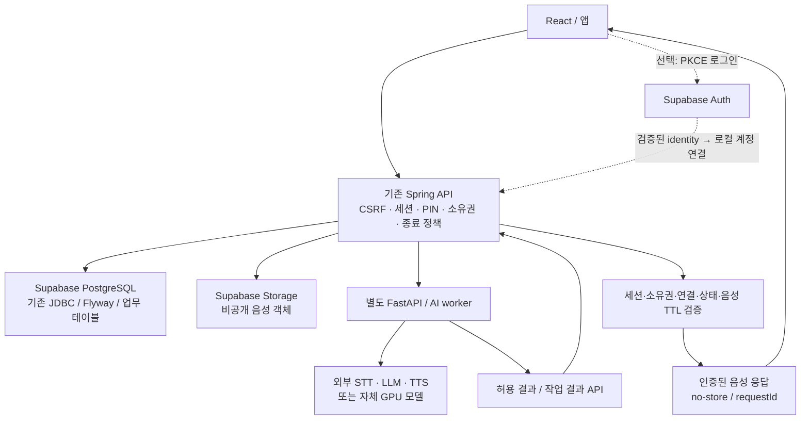

# Supabase와 대안: DodamDodam 적용 검토

조사 기준일은 2026-11-15다. 현재 backend 소스와 P0 문서를 기준으로 작성했다. STT·TTS·LLM 공급자, 예상 사용량, 월 예산은 **모두 미정**이라는 사용자 답변을 반영했다. 공급자 성능 순위나 최종 월 비용을 확정하지 않는다. 아래 권고는 조사 자료와 현재 구조를 조합한 설계 판단이며 실제 도입 완료를 뜻하지 않는다.

## 1. 현재 팀에 대한 판단

**Spring 업무 API와 별도 FastAPI AI 처리를 유지하고, Supabase의 관리형 PostgreSQL·비공개 Storage를 먼저 검증하는 방안을 권한다. OAuth는 별도 단계에서 효과를 비교한다.** AI 팀이 음성 품질과 안전 판정에 집중하도록 운영 부담을 줄이는 용도다. 현재 세션·소유권·PIN·대화 수명 정책을 BaaS에 전부 재작성하면 오히려 팀의 구현·검증 부담이 커진다.

단, DB만 필요하고 인증·Storage는 다른 서비스를 쓸 예정이면 Supabase가 자동으로 최선은 아니다. Neon 또는 Render Postgres와 기존 Spring 인증을 유지하는 편이 더 단순할 수 있다. 자체 GPU가 핵심이면 GPU 실행 위치를 먼저 선택하고 가까운 DB·파일 저장소를 비교해야 한다.

Supabase의 DB/Auth/Storage는 음성 엔진 선택과 다른 축이다. Edge Functions는 외부 AI API 조정에 쓸 수 있지만, 공개된 hosted 제한은 메모리 256MB·요청당 CPU 2초·wall time Free 150초/유료 400초다. 로컬 STT/TTS 모델 실행 기반으로 추천하지 않는다. 2026-10-27 발표된 **Supabase Compute도 확인했으나 private alpha**이며 현재 안내는 us-west-2·GPU 없음·운영용 아님이다. Edge Functions 제한을 Supabase 전체의 영구적 한계로 일반화하지 않되, 이번 P0의 운영 기반은 검증된 별도 worker로 잡는 편이 타당하다. [Edge 제한](https://supabase.com/docs/guides/functions/limits), [Compute alpha 발표](https://supabase.com/blog/supabase-compute-private-alpha)

## 2. 서비스 요구와 Supabase 기능의 대응

| 서비스 요구 | Supabase가 줄여주는 일 | 우리가 계속 구현할 일 | 판단 |
| --- | --- | --- | --- |
| PostgreSQL 운영 | DB 제공·관리 도구·플랜별 백업 | Flyway, SQL·잠금, 계정/대화 모델, 복구 시험 | 우선 PoC |
| 임시 응답 음성 | private bucket·업로드/다운로드 API | 음성 허용 여부, 만료·종료 차단, DELETE_PENDING/DELETED, 고아 파일 정리 | 후속 음성 기능과 도입 |
| Google 로그인 | 공급자 로그인·Auth 사용자·토큰 | 로컬 계정 연결, 기존 session_security, PIN·소유권, 로그아웃 정책 | 선택 도입 |
| 이메일 가입/비밀번호 | Auth 이메일 흐름 사용 가능 | 현재 목적별 challenge 계약과 통합 여부 결정 | OAuth만 도입하면 현행 유지 |
| PIN_SETUP/PIN_RESET | 직접 대체할 업무 기능 없음 | 현재 세션 binding·세대·PIN 버전·발급 보상 | 유지 |
| 음성 STT/TTS/LLM | 파일/메타데이터·연결 기반 | 모델·공급자, 디코딩, 한국어 아동 음성 성능, 안전 판정, 시간 제한 | AI 팀/FastAPI 유지 |
| 진행 상태 알림 | Realtime 활용 가능 | 소유권·세션 연결·종료 후 노출 차단, 재조회 권한 | P0는 기존 202/polling 우선 |
| 작업 큐 | Supabase Queues도 후보 | 중복 처리, deadline, 재시작 복구, 결과 저장 CAS | 외부 큐와 필요 시 비교 |
| pgvector/RAG | 벡터 기능 제공 | 실제 검색 요구·보관 정책·AI 팀 소유권 | 현재 요구 없으므로 추가하지 않음 |

Google·Kakao 로그인 연동 문서가 있지만 P0의 활성화 범위는 이메일·Google이다. 서비스가 제공하는 기능과 이번 제품에서 켤 기능을 구분한다. [Google](https://supabase.com/docs/guides/auth/social-sign-in/auth-google), [Kakao](https://supabase.com/docs/guides/auth/social-sign-in/auth-kakao), [Supabase 제품 범위](https://supabase.com/pricing)

## 3. 권장 구조 — 도입 시의 제안

다음은 현재 구현도가 아니라 **후속 구성안**이다. 1단계에서는 Auth까지 바꾸지 않아도 된다.



FastAPI에 전체 업무 DB 접근권을 주지 않는다. AI 요청에는 nickname 등 합의된 최소 문맥과 작업 ID·기한을 전달하고, AI 결과를 받는 backend가 저장·공개 정책을 결정한다. 큰 파일 때문에 backend 중계 부담이 실제 병목이 되면 제한된 내부 객체 접근 등 후속 전송 계약을 설계하되, 클라이언트가 업무 권한을 우회하지 않게 한다. 현재 API의 multipart 업로드를 signed upload로 바꾸는 것도 별도 API 계약 변경이다.

## 4. 현재 코드를 유지·변경·추가할 위치

| 현재 코드/기반 | 유지할 것 | 도입 시 변경 또는 추가 |
| --- | --- | --- |
| `child/api`, `child/application` | API 응답·정규화·소유권 검증 | DB 이전만으로 controller/service 재작성 불필요 |
| `ChildRepository` | SQL·계정 FK·아이 개수 제약 | 새 DB에서 migration·제약 검증 |
| `ConversationService`, `ClosureCoordinator` | idempotency·잠금·자정·ACTIVE/CLOSING/ENDED·복구 규칙 | 후속 음성 저장소/worker를 연결하되 현재 상태 전이 재사용 |
| `ConversationStartResponseFilter` | 응답 commit 직전 접근 재검사 | 음성 응답도 별도 최신 접근 검사 구현 |
| `AuthenticatedSessionService.validate` | 로컬 UUID principal·세션 문맥·버전·폐기·만료 검사 | Auth bridge가 최종적으로 같은 로컬 UUID principal 생성 |
| `SessionLifecycleService` | 새 로그인 문맥·실제 세션 저장 확인·실패 보상 | 외부 Auth 성공 후 기존 로그인 전략으로 진입 |
| `LoginSessionAuthenticationStrategy`, `LoginSecurityContextRepository` | 세션 교체·CSRF 교체·문맥 저장 | bridge Authentication 입력 경로 추가, 실제 실패 계약 시험 |
| `SessionSecurityRepository`, `GuardianAccessService` | 즉시 폐기·PIN 버전·보호자 기한 | Supabase JWT의 유효성과 업무 권한을 별도로 검증 |
| `EmailVerificationIssuanceService`, `DeliveryService` | 현재 이메일 발급·PIN 목적·보상 정책 | OAuth만 도입하면 유지. 이메일 Auth까지 이관할 때는 별도 전체 계약 재설계 |
| `GlobalApiRateLimitFilter` 등 | backend API 예산·전송 검사 | Supabase Auth 직접 요청의 남용 방지와 별개로 운영. 신뢰 proxy D17 결정 필요 |
| `SecurityConfig`, `OAuth2ClientConfig` | CSRF·CORS·인가·오류 처리 | Supabase 선택 시 직접 Google OAuth와 bridge 중 하나를 명확히 선택 |
| JDBC/Flyway/Spring Session | 기존 테이블·migration 이력·테스트 | datasource/TLS/권한·풀 크기·migration 전용 연결 검증 |
| `application.yml`, Compose, CI | 환경별 외부 설정·비밀 파일·Testcontainers | DB/Storage 설정 추가, `.env.example`·설정 문서·계약 검사 갱신 |
| 아직 없는 계정 identity 저장소 | 기존 `accounts.id` | 새 migration으로 공급자 subject↔로컬 account 연결. ERD `auth_identities`와 정합성 검토 |
| 아직 없는 음성 저장소 | 기존 발화·대화 상태 | `turn_audio_assets` 후속 migration과 최소 Storage adapter, 삭제 재시도 |

### DB 연결은 단순 URL 변경 후 끝내지 않는다

Supabase는 장기 실행 JVM/컨테이너에 direct connection을 권장하고, IPv4 전용 환경에서는 session pooler를 대안으로 제공한다. 우선 이 두 가지를 비교한다. transaction pooler를 채택하려면 해당 제품 버전의 준비 문장·세션 상태·lock 호환성을 별도로 검증한다. 이 코드의 `pg_advisory_xact_lock`은 **트랜잭션 범위 잠금**이므로 “pooler라서 advisory lock이 전부 안 된다”고 단정하면 틀리다. Flyway의 잠금/세션 요구와는 구분한다. [공식 연결 방식](https://supabase.com/docs/guides/database/connecting-to-postgres), [풀과 연결 제한](https://supabase.com/docs/guides/database/connecting-to-postgres/pooling-and-limits)

현재 로컬 PostgreSQL 18.6과 실제 발급받은 Supabase 인스턴스의 major·minor·확장을 비교하고 `select version()`부터 확인한다. 버전이 같다고 가정하지 않는다. TLS는 서버 인증서·hostname 검증을 포함하고, 앱의 최대 연결 수는 `앱 인스턴스 수 × 각 Hikari pool + migration/운영 연결 + Supabase 내부 사용량`으로 계산한다. 공개 API 요청마다 DB 예산을 예약하므로 음성 polling 빈도도 DB 부하를 만든다. [DB 버전 확인](https://supabase.com/docs/guides/database/postgres/which-version-of-postgres)

Flyway를 업무 schema의 단일 변경 주체로 유지한다. 기존 V1~V7 파일을 수정하거나 Supabase Auth/Storage의 관리 schema를 기존 migration으로 덮어쓰지 않는다. 전용 migration role과 최소 권한 application role을 분리하고 `flyway_schema_history`·기존 PK/FK/인덱스/부분 UNIQUE·DB clock·잠금 동작을 검증한다.

### 현재 schema를 클라이언트에 직접 공개하지 않는다

현재 SQL migration만으로 Supabase Data API용 RLS 정책이 완성되지는 않는다. 기존 세션 쿠키는 Supabase가 자동으로 이해하는 `auth.uid()`가 아니다. 이 구성은 DB에 JDBC로 연결하므로 **업무 DB Data API를 끄는 방안이 가장 단순하다.** 필요한 경우에만 별도 노출 schema와 RLS/최소 grant를 설계한다. 프로젝트 생성 시점에 따라 기본 grant 동작도 다르므로 실제 권한을 확인한다. Storage API의 별도 접근 제어도 함께 검증한다. [Data API 비활성화·권한](https://supabase.com/docs/guides/api/securing-your-api), [안전한 DB 접근 방식](https://supabase.com/docs/guides/database/secure-data)

## 5. Supabase Auth: 언제 유리하고 어떻게 연결할까

이메일·소셜 계정 관리/복구·공급자 추가 부담을 줄이고 싶다면 유효한 선택이다. 현재 P0의 Google 한 종류만 연동한다면 이미 있는 Spring OAuth2 Client를 완성하는 쪽이 변경 범위가 작다. DB·Storage 도입을 위해 Supabase Auth까지 채택할 필요는 없다. 현재는 공급자 OAuth 등록 자체보다 로컬 계정과의 매핑·업무 세션 통합을 어떻게 보장할지가 핵심이다.

선택안 A는 **현재 Spring OAuth2 Client + Google을 완성**하는 것이다. 새로운 인증 사업자를 추가하지 않고 표준 라이브러리를 재사용하며, 기존 세션 모델과 자연스럽게 연결한다. 선택안 B는 **Supabase Auth + Spring 세션 bridge**다. 공급자 흐름의 일부를 위임하지만 callback·토큰 검증·계정 연결·세션 발급을 구현해야 한다. Supabase를 붙인다고 현재 Spring `oauth2Login`의 issuer 설정만 바꾸면 끝난다고 가정하지 않는다.

bridge의 논리 순서는 다음과 같다.

1. 합의한 OAuth/PKCE 흐름에서 state·code verifier 등을 서버 정책에 맞게 보관하고 callback의 재사용·CSRF·잘못된 redirect를 차단한다.
2. code 교환 결과를 서버에서 검증한다. 허용 issuer·audience·서명 알고리즘/JWKS·만료·subject를 확인하며 선택한 흐름이 요구하는 nonce 등도 검증한다. 브라우저가 보내는 email/accountId를 계정 연결 근거로 믿지 않는다.
3. 검증된 Supabase 사용자 ID/원 공급자 identity를 **별도 mapping**으로 로컬 `accounts.id`에 연결한다. `auth.users.id == accounts.id`라고 가정하지 않는다. 이메일이 같다는 이유로 기존 계정에 자동 병합하지 않는다.
4. 기존 로그인 전략에 **로컬 계정 UUID를 principal name**으로 갖는 Authentication을 전달한다. 현재 `SessionLifecycleService.beginLogin`은 이 규칙을 요구한다.
5. 기존 서버 세션·securityContext·CSRF 발급·저장 확인·실패 보상을 수행한다. 프론트의 일반 업무 API 호출은 기존 세션 계약을 따른다.
6. 로컬 로그아웃과 공급자 refresh session의 정리 범위·이중 실패 처리를 명시한다. Supabase의 global signout을 전체 Google 계정 로그아웃으로 해석하지 않는다.

Supabase의 signout은 이미 발급된 access token을 즉시 무효화하지 않으며 만료까지 유효할 수 있다. 따라서 JWT 서명 확인만으로 현재의 즉시 세션 폐기·보호자 PIN 재설정 정책을 대체할 수 없다. bridge 이후 Supabase 세션을 어떻게 보관/갱신/폐기할지도 별도 계약이다. 외부 세션이 폐기되었을 때 로컬 세션을 즉시 닫아야 하는지 제품 정책을 정하고 재검증/동기화 경로를 설계한다. [Signout 동작](https://supabase.com/docs/guides/auth/signout), [세션·토큰](https://supabase.com/docs/guides/auth/sessions)

PIN_SETUP/PIN_RESET challenge는 로그인 OTP와 목적·세션 binding·세대·버전이 다르므로 유지한다. Supabase 이메일 인증으로 SCRUM-77을 통째로 제거하지 않는다. 향후 이메일 가입/비밀번호까지 이전한다면 일회용 proof, eligible/decoy 응답, 재발급 폐기, 비밀번호 변경에 따른 기존 문맥 폐기를 새 흐름과 대조한 뒤 결정한다.

## 6. Storage에서 가장 중요한 계약: URL 만료와 업무 권한은 다르다

Supabase private bucket을 쓰는 것은 적합하지만 클라이언트에 긴 signed download URL을 건네주는 방식은 현재 계약과 충돌할 수 있다. 공식 문서상 signed URL은 지정 만료 시점까지 유효하고 Auth 키 변화로 즉시 사라지지 않는다. 사용자 로그아웃·대화 CLOSING·자정·PIN 변경은 해당 URL의 자체 만료를 자동으로 당기지 않는다. 프로젝트 키 전체 폐기는 개별 대화 종료 수단으로 쓰기 어렵다. [Storage signed URL](https://supabase.com/docs/guides/storage/security/signing-keys), [다운로드 방식](https://supabase.com/docs/guides/storage/serving/downloads)

P0에는 다음 구성이 맞다.

- 비공개 객체 키와 파일 메타데이터를 backend가 관리한다. public bucket/추측 가능한 공개 URL을 사용하지 않는다.
- 클라이언트는 기존 계약의 인증된 음성 GET을 호출한다. backend가 로그인→아이 소유권→대화/발화 조합→상태/시간→연결→별도 음성 허용→TTL을 검사한다.
- backend 또는 동등한 권한 검증 gateway가 객체를 읽어 응답한다. 아직 구현하지 않은 음성 전달 단계에도 최신 권한 검사와 `no-store`를 적용한다. 한번 전송된 바이트를 회수할 수는 없으며 진행 중 전송 중단의 범위는 후속 음성 계약에서 정의한다.
- 종료/만료 때 업무 접근을 먼저 거부하고 DELETE_PENDING을 남긴다. 물리 삭제 성공 뒤 DELETED, 실패하면 재시도한다. 과거 메타데이터 복구가 삭제된 음성 파일을 되살린다고 가정하지 않는다.
- Storage의 server key는 서버에서만 사용한다. service key는 RLS를 우회할 수 있으므로 backend의 권한 검사를 빠뜨리면 Storage 정책이 대신 막아주지 않는다. [Storage 권한](https://supabase.com/docs/guides/storage/security/access-control)

DB 백업은 Storage 객체의 실제 내용까지 포함하지 않는다. 음성을 백업할지, 삭제를 우선할지 보관 정책과 함께 결정하고 DB/객체 복구를 따로 시험한다. [백업 범위](https://supabase.com/docs/guides/platform/backups)

## 7. 대체 수단 비교

제품 전체와 DB·인증·실행 환경을 섞어 순위를 매기면 판단이 흐려진다. 아래는 현재 구조를 보존하며 선택 가능한 주요 범주다. 시장의 모든 상품을 망라했다는 뜻은 아니며 한국어 음성 서비스에 관련 있는 대표 대안을 포함했다. 운영 부담·변경량은 현재 코드에서 추론한 상대 평가다.

| 대안 | 현재 코드 재사용 | AI/STT·TTS 관점 | 운영·변경 부담 / 선택 조건 |
| --- | --- | --- | --- |
| **Supabase PG + Storage + 기존 Spring 인증** | 매우 높음 | 엔진 자유, AI worker는 별도 | 작은 팀의 DB·파일 운영 축소에 적합. 우선 후보 |
| **Supabase + Auth bridge** | 높음, 인증 연결 추가 | 위와 같음 | 소셜/이메일 관리 위임 효과가 bridge·계약 유지 비용보다 클 때 |
| **AWS RDS/Aurora PG + S3 + Spring/Cognito + EC2/ECS** | PG·Java·Python 재사용 높음 | Transcribe/Polly 또는 외부 API·GPU 실행 조합 | VPC/IAM·큐·복구·인프라 설계 필요. AWS 경험·크레딧·GPU 배치가 유리할 때. [RDS](https://docs.aws.amazon.com/AmazonRDS/latest/UserGuide/CHAP_PostgreSQL.html) |
| **GCP Cloud SQL PG + Storage + Cloud Run + Firebase Auth** | JDBC 유지, Auth는 bridge | Google Speech/TTS·외부 API. Cloud Run GPU도 제공 | GPU 종류별 지원 리전·quota·과금 확인 필요. [Cloud Run GPU](https://docs.cloud.google.com/run/docs/configuring/services/gpu) |
| **Neon PG + R2/S3 + Spring 인증** | 높음 | AI worker 자유, DB만 가볍게 위임 | 여러 공급자 연결·리전/전송 비용 관리. scale-to-zero 재개 영향을 측정. 현재 Neon 문서는 Auth/Storage 등도 포함하므로 “DB만 가능한 서비스”로 단정하지 않음. [JDBC](https://neon.com/docs/guides/java), [재개/중지](https://neon.com/docs/introduction/scale-to-zero), [R2 과금](https://developers.cloudflare.com/r2/pricing/) |
| **Render / Railway: Spring + FastAPI + Postgres** | 높음 | 컨테이너 서비스 배포 단순화, 외부 음성 API 조합 | 작은 팀의 배포 편의 대안. DB 관리 책임·백업·리전·idle 정책은 상품별 확인. [Render](https://render.com/docs/postgresql-creating-connecting), [Railway](https://docs.railway.com/databases/postgresql) |
| **Firebase Firestore 중심 전환** | SQL·FK·부분 UNIQUE·잠금 로직 재설계 | 음성 엔진은 여전히 별도 | 새 모바일 프로젝트에는 편할 수 있으나 현재 PG 업무 규칙의 이전 비용이 커서 비권고. SQL Connect와 구별 |
| **Firebase SQL Connect(기존 Data Connect)** | PostgreSQL 사용 가능 | AI 실행과 별개 | Cloud SQL + 생성 API/SDK 경로. 이미 있는 Spring 업무 API와 권한/스키마 관리가 중복되는지 비교. “Firebase=NoSQL뿐”은 틀림. [SQL Connect](https://firebase.google.com/docs/sql-connect) |
| **Appwrite** | native Managed PostgreSQL 경로라면 높음 | 별도 AI 실행 | 현재 문서는 네이티브 PG와 TablesDB/DocumentsDB를 구별한다. native PG·리전·SLA 비교 후보이며 managed API로 갈아타면 권한/Tx 재설계. [Managed PG](https://appwrite.io/docs/products/databases/postgresql) |
| **자체 PG + S3 호환 저장소 + Keycloak / 자체 Spring 인증** | 매우 높음 | 자체 GPU/내부 네트워크 구성 자유 | 백업·장애·보안 패치·복구·인증 서버 운영 책임이 팀에 남음. 운영 담당자가 명확할 때. [Keycloak](https://www.keycloak.org/guides), [Supabase self-host](https://supabase.com/docs/guides/self-hosting/docker) |
| **PocketBase** | 낮음, SQLite 중심 | STT/TTS 별도 | 간단한 prototype 후보. 현재 PG 잠금·세션·상태 전이 보존 목적에는 비권고. [공식 구조](https://pocketbase.io/docs/) |

OAuth만 위임하는 대안으로 Auth0·Cognito·Firebase Auth·Clerk도 비교할 수 있다. 이들은 DB/음성 엔진 대체재가 아니며, 로컬 계정 mapping·PIN·소유권·응답 권한 재검사는 동일하게 필요하다. Auth0의 PKCE 등 표준 흐름을 쓰더라도 업무 세션 통합을 생략하지 않는다. [Auth0 PKCE](https://auth0.com/docs/get-started/authentication-and-authorization-flow/authorization-code-flow-with-pkce), [Cognito](https://docs.aws.amazon.com/cognito/latest/developerguide/cognito-user-pools.html), [Firebase Auth](https://firebase.google.com/docs/auth), [Clerk](https://clerk.com/docs)

## 8. STT·TTS 대안은 별도 실험으로 선택한다

특정 STT와 특정 TTS를 반드시 같은 회사로 맞출 필요는 없다. 다음은 P0의 명시적 STT→허용 판정/LLM→TTS 파이프라인에 적용 가능한 후보군이다. “한국어 지원”은 아동 음성에서의 품질 보증이 아니며 공급자의 홍보 정확도 수치로 서비스 성능을 확정하지 않는다.

처음부터 모든 공급자 adapter를 구현할 필요는 없다. Spring은 합의된 FastAPI 계약 하나를 사용하고, AI 팀이 첫 공급자를 연결한 뒤 실제 교체 필요가 생긴 경계만 분리한다.

| 후보 | 활용 방향 | 우리 서비스에서 비교할 것 | 공식 근거 |
| --- | --- | --- | --- |
| OpenAI Audio | STT·TTS·LLM을 API로 조합 | 한국어 이름/아동 발음·무음 판정·실패/기한·음성별 품질. TTS 문서는 영어 최적화도 명시 | [STT](https://developers.openai.com/api/docs/guides/speech-to-text), [TTS](https://developers.openai.com/api/docs/guides/text-to-speech) |
| Google Cloud Speech/TTS | STT·TTS를 GCP 실행 환경과 조합 | ko-KR 모델/리전/음성, 짧은 발화, 실제 첫 음성 지연 | [STT 언어](https://docs.cloud.google.com/speech-to-text/docs/speech-to-text-supported-languages), [TTS 음성](https://docs.cloud.google.com/text-to-speech/docs/list-voices-and-types) |
| Azure Speech | 한국어 STT/TTS·음성 선택 | 기능별 ko-KR 지원·리전·발음·운영 환경 | [언어·음성 표](https://learn.microsoft.com/en-us/azure/ai-services/speech-service/language-support) |
| AWS Transcribe/Polly | AWS 인프라와 결합 | 한국어 batch/streaming 지원 차이·음성 선택·리전. 지원 언어와 모든 기능 지원은 다름 | [Transcribe](https://docs.aws.amazon.com/transcribe/latest/dg/supported-languages.html), [Polly](https://docs.aws.amazon.com/polly/latest/dg/supported-languages.html) |
| NAVER CLOVA Speech/Voice | 한국어 중심 평가 후보 | 아동 음성·닉네임·짧은 입력/codec, 기본 요금·문자 제한 | [Speech](https://guide.ncloud-docs.com/docs/clovaspeech-spec), [Voice](https://guide.ncloud-docs.com/docs/clovavoice-spec) |
| ElevenLabs | STT 또는 캐릭터 TTS 후보 | 한국어 지원 모델·동일 음성 유지·상업 사용 조건·실제 비용 | [STT](https://elevenlabs.io/docs/overview/capabilities/speech-to-text), [모델](https://elevenlabs.io/docs/overview/models) |
| Deepgram | STT 또는 TTS 후보 | 한국어 모델·voice별 지원·정규화·streaming 요구. STT 지원만으로 모든 TTS 지원을 추론하지 않음 | [STT](https://developers.deepgram.com/docs/language), [TTS](https://developers.deepgram.com/docs/flux-tts/voices) |
| 자체 모델/혼합 | Whisper 등 자체 STT + 평가된 한국어 TTS, 또는 한쪽만 API | GPU 메모리·동시성·warmup·큐 지연·모델별 license·운영 인력. 공개 Whisper와 hosted API 모델 수명은 별개 | [Whisper 코드/weights](https://github.com/openai/whisper) |

실시간 speech-to-speech/음성 agent 서비스도 대안이지만 현재 P0의 필드별 허용·허용 텍스트 보존·TTS 전체 실패 처리와 충돌하지 않는지 따로 설계해야 한다. 검증 전 생성 오디오를 바로 아이에게 흘리는 형태로 전환하지 않는다. 현재 계약은 multipart 파일 발화이므로 WebSocket/WebRTC 도입은 DB 공급자 선택과 별개의 제품 변경이다.

권장 비교 실험은 ①동일 codec의 짧은 한국어 발화·이름·잡음·침묵·불완전 문장 집합, ②STT 문자 오류율(CER)과 닉네임 인식, ③TTS 이해도·톤·읽기 오류, ④녹음 종료→텍스트/재생 가능 시점의 p50/p95, ⑤무음·거부·TTS 실패·timeout 계약, ⑥성공 발화 1건당 실제 비용이다. 아동 데이터는 팀이 사용 권한을 확보한 자료로 평가하고 운영 녹음을 임의로 모으지 않는다.

## 9. 비용은 DB 요금과 음성 처리 비용을 분리한다

조사 시 Supabase Pro 시작가는 월 **$25**, 첫 Micro compute를 커버하는 월 $10 compute credit이 포함된다. 기본 DB disk 8GB·Storage 100GB·uncached egress 250GB·cached egress 250GB이며, 추가 project/compute·용량·전송·부가 기능은 별도다. 모든 서비스가 $25에 무제한인 것은 아니다. Free는 비활성 중지 정책이 있어 운영/고정 시연 환경과 다르게 평가한다. 환율·세금은 포함하지 않은 USD 기준이다. [공식 가격](https://supabase.com/pricing), [과금 구조](https://supabase.com/docs/guides/platform/billing-on-supabase)

서비스 원가의 계산 단위는 다음과 같다. 공급자가 문자·분·토큰 중 무엇으로 청구하는지 선택한 모델별 최신 단가를 넣는다.

```text
월 비용 = DB/Auth/Storage 기본료 + Spring/FastAPI 실행 비용 + 추가 전송/저장
        + STT 입력 분 × STT 단가
        + TTS 출력 분 또는 문자/오디오 토큰 × 해당 단가
        + LLM 입력/출력 토큰 × 해당 단가
        + 재시도/실패/로그/관측/백업 비용
```

**가정 예시**: 일 사용자 100명 × 하루 10발화 × 입력 15초/출력 10초 × 30일이면 월 30,000발화·STT 7,500분·TTS 5,000분이다. 32kbps 압축 오디오만 가정하면 입력 약 1.8GB, 출력 약 1.2GB가 생성된다. 16kHz·mono·16bit 비압축 입력은 약 14.4GB다. 이는 제품 제한이나 청구 예측이 아니라 codec에 따른 차이를 보여주는 산식이다. 사용자 1,000명이면 동일 조건에서 모두 10배다.

객체 평균 보관량은 `일 생성 바이트 × 보관일`로 추산하고 임시 음성 TTL이 결정되면 다시 계산한다. backend가 Storage를 읽어 앱에 중계하면 Storage→backend와 backend→사용자 전송을 모두 비용 경로에 포함한다. AI 재읽기·재생 횟수·실패 재시도는 별도다. `no-store` 음성을 cached CDN 비용 절감으로 단정하지 않는다. R2의 인터넷 egress 무료 정책도 객체 요청·저장·backend 측 전송 비용이 모두 무료라는 뜻은 아니다. [Supabase egress](https://supabase.com/docs/guides/platform/manage-your-usage/egress), [R2 가격](https://developers.cloudflare.com/r2/pricing/)

이 조건에서는 “Supabase를 쓰면 AI 비용이 절감된다”는 결론을 낼 수 없다. 주된 이익은 DB/파일/인증 운영 시간을 줄이는 것이며, 음성 비용은 발화량과 선택 엔진이 좌우한다. 공급자·규모 미정이므로 서로 다른 상품의 무료 크레딧을 정상 운영 원가처럼 합산하지 않았다.

## 10. 도입을 결정한다면 진행 순서

1. **음성 계약과 실행 위치 정리**: D13/D14의 codec·길이·용량·timeout·필드별 허용과 D17의 리전·보관을 AI/FE와 확정한다. 한국어 평가 표본과 p95·성공 발화당 비용 목표를 정한다.
2. **DB 단독 PoC**: 별도 비운영 프로젝트에서 실제 PG 버전·TLS·direct/session 연결을 확인한다. V1~V7을 새 DB에 적용하고 세션·중복 시작·이메일 재발급·동시 잠금·오류 계약을 검증한다. 업무 Data API를 끄고 최소 권한을 확인한다.
3. **실제 배포 지역에서 측정**: Supabase는 Seoul 리전을 제공하지만 AI 공급자/GPU가 같은 리전에 있다는 뜻은 아니다. Spring·AI·DB·Storage 사이 RTT와 cold start·최대 연결·큐 대기를 측정한다. [리전](https://supabase.com/docs/guides/platform/regions)
4. **Storage PoC**: 현재 계약의 인증된 음성 GET을 기준으로 private 저장·허용 결과만 메타데이터 저장·로그아웃/종료/만료 차단·삭제 재시도·고아 파일을 시험한다. 실제 음성 API 구현과 함께 반영한다.
5. **OAuth 선택**: 직접 Spring Google 구현과 Supabase bridge의 구현·운영 비용을 비교한다. bridge가 유리하면 새 identity mapping·callback·세션 통합을 구현한다. 이메일 인증·PIN·로컬 세션을 동시에 교체하지 않는다.
6. **통합 검증**: native HTTP·CSRF/CORS·response commit 직전 폐기·DB 장애·SMTP 보상·동시 요청·callback 중복·late AI 결과·CLOSING 차단을 검증한다. 클라우드 endpoint를 테스트에 강제로 박지 않고 기존 PostgreSQL Testcontainers 검증도 유지한다.
7. **이전·되돌림 리허설**: 사용 데이터가 있으면 쓰기 중단/동기화 방식을 먼저 정한다. PK/FK/행 수·Flyway history·세션 직렬화·키 파일을 확인한다. 두 DB에 동시에 쓰는 상태를 임의로 만들지 않는다. 이전 후 쓰기를 허용한 경우 단순히 예전 DB URL로 돌리는 것은 안전한 rollback이 아니다.
8. **실측 후 유료 크기 선택**: 예산 경보·백업 복구·오류율·AI 지연·egress를 보고 compute를 조정한다. Realtime·queue·RAG는 병목/요구가 확인된 것부터 추가한다.

현재는 조사·설계만 수행했다. 실제 Supabase 프로젝트 생성, 데이터 이전, OAuth 전환, AI 공급자 계정 생성, 유료 결제 또는 운영 배포는 하지 않았다. 최종 선택 전 남은 근거는 실제 한국어 아동 음성 평가, 동시 사용자/발화량, 월 예산, 배포 리전, 보관 정책, 목표 장애 복구 수준이다.
